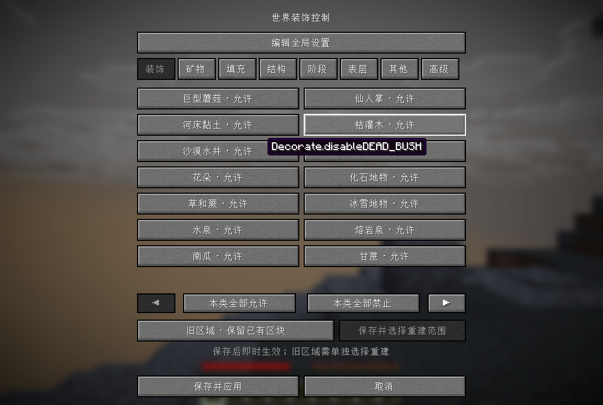
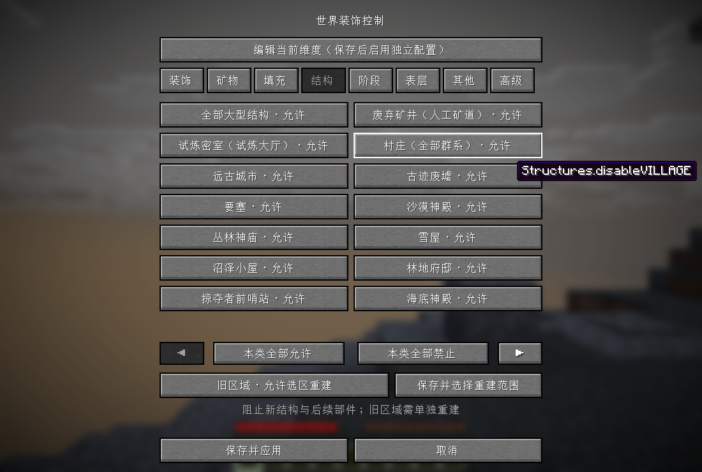
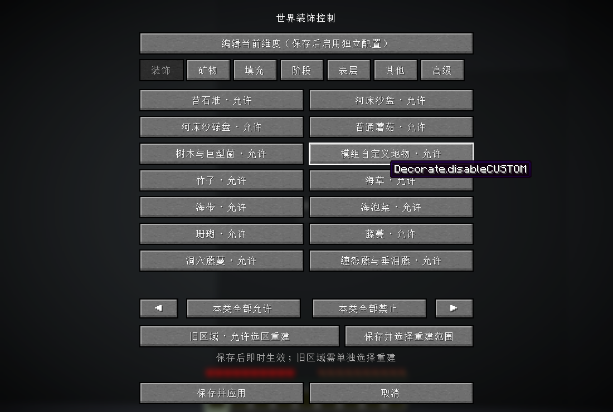
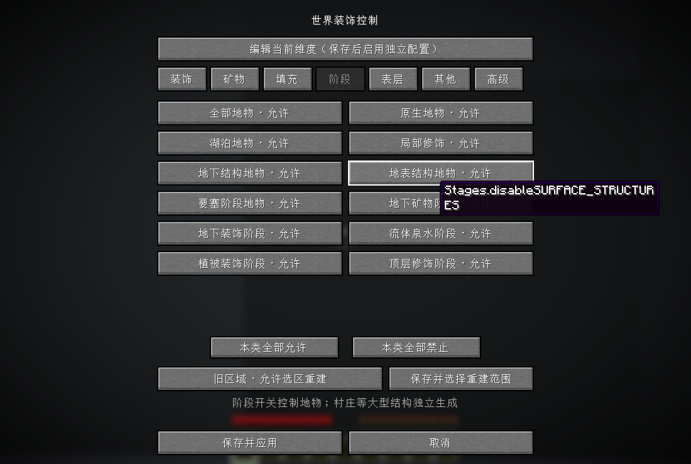
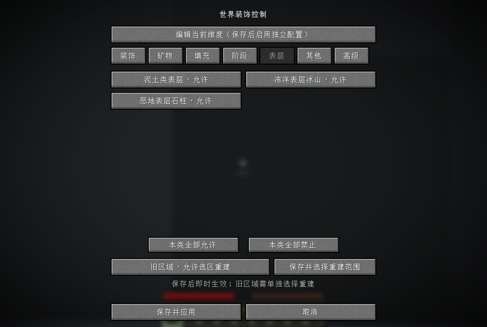
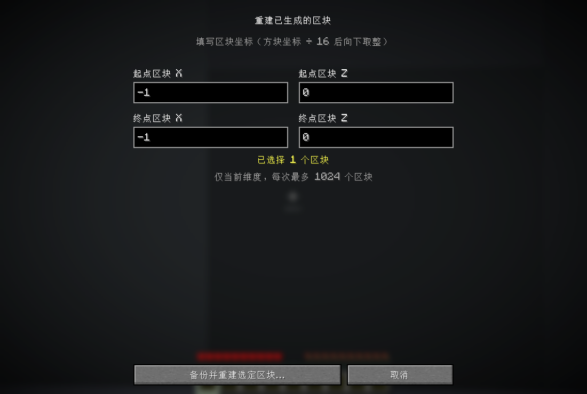
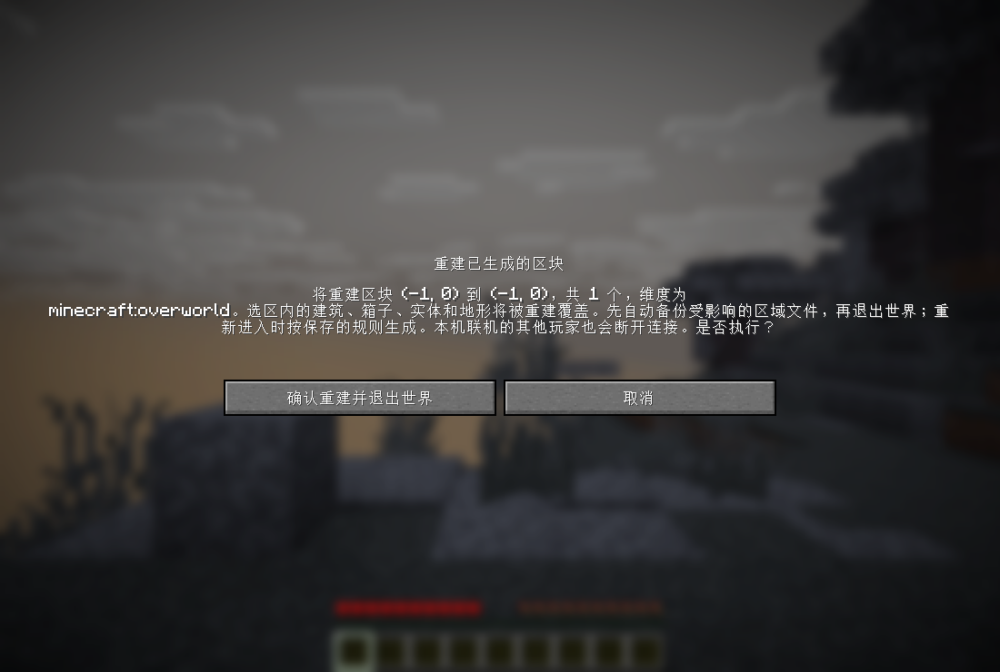

# Ore Control — Fabric 26.1.2

通过游戏内按钮控制矿物、植被、湖泊、大型结构和其他世界装饰，也可以选择已有区块，备份后按新的规则重新生成。

这是 masa 的 Ore Control 0.4.3 的非官方移植，保留原项目历史和 LGPL-3.0 许可证。原始提交为 `6323cb359b21406395958f257c10de4298c19cbf`，原项目位于 https://github.com/maruohon/orecontrol 。当前源码与发布位于 https://github.com/unionofblackbean/orecontrol-fabric 。

## 安装

需要 Minecraft Java 26.1.2、Java 25、Fabric Loader 0.18.4 或更新兼容版本。

1. 从本仓库 Releases 下载 `orecontrol-fabric-1.2.0+mc26.1.2.jar`，用它替换实例 `mods` 文件夹里的旧版 Ore Control JAR。
2. 要使用游戏内界面，在同一个客户端安装适配 26.1.2 的 [Mod Menu](https://modrinth.com/mod/modmenu)，已实测 Mod Menu 18.0.2。
3. 启动游戏，进入世界，按 Esc 打开模组菜单，选择 Ore Control，再点击配置按钮。也可以从主菜单的模组列表打开配置界面。

Ore Control 本体无需单独安装 Fabric API。Mod Menu 有自己的依赖，请通过其下载页或启动器安装。配置界面和重建操作支持单人世界与本机开启联机的主机。联机访客与独立服务器的客户端不会通过此界面修改远端配置；独立服务器仍可使用下文的 CFG 文件配置。

## 用按钮控制世界装饰

界面提供“装饰”“矿物”“填充”“结构”“阶段”“表层”“其他”“高级”八个分类，项目较多时通过左右箭头翻页。

- 点击项目按钮，在“允许”和“禁止”之间切换。泥土团块、树木、草和蕨、花、蘑菇、矿石、泉水等都可分别设置。
- 点击“保存并应用”后，规则立即用于后续的生成步骤。点击“取消”会放弃尚未保存的编辑。
- “其他”分类中的“仅禁止地表熔岩湖”使用“开启”和“关闭”，开启后允许地下熔岩湖。
- 在本机世界内，顶部按钮可以切换“全局设置”和“当前维度”。保存当前维度的编辑会自动启用独立维度配置。



## 1.2.0 的大型结构控制

进入“结构”分类，将“废弃矿井（人工矿道）”“试炼密室（试炼大厅）”或“村庄（全部群系）”切换为“禁止”，再点击“保存并应用”。要同时关闭所有大型结构，将“全部大型结构”设为“禁止”。“本类全部禁止”还会将所有单项开关一起设为禁止。

按实际结构注册表审计的 **34 个原版结构 ID** 全部有对应开关，详见[结构覆盖对照表](docs/structure-audit-26.1.2.md)。

| 分组 | 控制内容 |
| --- | --- |
| 矿井、试炼密室、村庄 | 普通与恶地矿井、试炼密室，以及平原、沙漠、雪原、针叶林和热带草原村庄 |
| 地下遗迹 | 远古城市、古迹废墟、要塞 |
| 地表建筑 | 沙漠神殿、丛林神庙、雪屋、沼泽小屋、林地府邸、掠夺者前哨站 |
| 海洋遗迹 | 海底神殿、冷水与暖水海底废墟、海中与搁浅沉船、埋藏的宝藏 |
| 下界与末地 | 全部废弃传送门变体、下界要塞、堡垒遗迹、下界化石、末地城 |
| 自定义结构 | 模组或数据包自有命名空间、通过原版 Structure 管线生成的结构 |

关闭后会阻止新结构起点的创建、周边结构引用的新增，以及已有结构向后续区块放置部件。定位指令和探险地图查询也会排除被禁止的结构，包括已有结构起点。重新允许后，这些查询恢复使用原有规则。

保存开关后，已放置的建筑方块会继续保留。要移除旧建筑，请按下文选择覆盖建筑完整范围的旧区块并重建。新增结构开关默认允许，升级后请主动设置。

“阶段 → 全部地物”控制地物装饰，“结构 → 全部大型结构”控制大型结构生成。若希望两类都关闭，请同时设置这两个总开关。世界自身的“生成结构”设置也参与控制。



## 1.1.0 的高版本地物补全

上一版主要覆盖旧版项目，遗漏了部分 26.1.2 地物。现已对游戏实际注册的 **221 个配置地物和 258 个放置地物** 进行审计，逐个执行开关判定，并生成[完整对照表](docs/worldgen-audit-26.1.2.md)。自然装饰引用的命名配置地物均能由单项或组合控制关闭，匿名内联地物也受阶段控制。

新增 36 类地物控制和 4 类地下资源团块控制。凝灰岩单项开关也会约束大型铁矿脉伴生的凝灰岩。

| 类别 | 补充内容 |
| --- | --- |
| 水生植物 | 海草、海带、海泡菜、珊瑚 |
| 地表植物 | 竹子、藤蔓、甜浆果灌木、普通灌木、萤火虫灌木、落叶堆、西瓜 |
| 繁茂洞穴与苍白花园 | 洞穴藤蔓、苔藓与苍白苔藓、垂滴叶、洞穴黏土、孢子花、杜鹃根系 |
| 下界与末地 | 缠怨藤与垂泪藤、下界菌根与苗、紫颂植株、玄武岩柱与团块、黑石斑块、三角洲地物、末地小岛、黑曜石柱、折跃门与平台 |
| 其他地物 | 发光地衣、幽匿地物、滴水石、紫晶晶洞、冰山、蓝冰、水下岩浆块、地物形式的方块堆、草土圆盘 |
| 地下资源 | 凝灰岩、黏土、黑石、灵魂沙团块 |

树木装饰器附带的藤蔓、落叶，以及苔藓混合地物中的草，也会按对应开关检查最终方块写入。这样可以单独禁止藤蔓、落叶或草，同时继续允许树木与苔藓生成。

“本类全部允许”和“本类全部禁止”可批量修改当前分类。新开关默认允许生成，升级时会保留旧配置，请主动设置新增项目。



## 关闭全部地物与泥土表层

如果希望关闭所有初次自然装饰，进入对应的全局或当前维度配置，将“阶段 → 全部地物”设为“禁止”。也可以分别控制下表中的 11 个阶段。地下矿物阶段与全部地物总开关也会抑制噪声生成的大型铁铜矿脉。

| 阶段 | 典型内容 |
| --- | --- |
| RAW_GENERATION | 末地小岛 |
| LAKES | 熔岩湖 |
| LOCAL_MODIFICATIONS | 紫晶晶洞、冰山、大型滴水石 |
| UNDERGROUND_STRUCTURES | 怪物房、化石地物 |
| SURFACE_STRUCTURES | 沙漠水井、冰刺、蓝冰、玄武岩柱、末地柱与折跃门地物 |
| STRONGHOLDS | 当前原版没有放置地物 |
| UNDERGROUND_ORES | 矿石、泥土与岩石团块 |
| UNDERGROUND_DECORATION | 下界装饰、滴水石、幽匿等 |
| FLUID_SPRINGS | 泉水地物 |
| VEGETAL_DECORATION | 地表、洞穴与水生植被 |
| TOP_LAYER_MODIFICATION | 冻结、积雪、部分平台地物 |



**地表泥土在地物装饰之前由表层规则生成。** “矿物 → 泥土团块”控制地下资源团块。要去掉地表土层，另将“表层 → 泥土类表层”设为“禁止”，使新生成区块在表层阶段的泥土、草方块、砂土、缠根泥土、灰化土、菌丝体与泥巴替换成维度的基础岩石。地物本身生成的草土圆盘、杜鹃根系和苔藓等由各自开关或阶段总开关控制。

表层分类还可分别关闭冻洋的表层冰山扩展和恶地表层石柱。冰山的单项开关也会抑制冻洋表层冰山扩展。



阶段开关作用于 PlacedFeature。村庄等大型 Structure 使用“结构”分类控制，基础山体、洞穴和天然海水由地形生成决定。出生奖励箱、玩家使用骨粉或树苗、指令放置、末影龙重生等 ServerLevel 直接入口继续使用原有规则。结构内部单独放置的方块由结构开关整体控制。

已存在的树木、矿石和土层不会仅因保存规则就被移除。请探索未生成的区块，或者使用下面的选区重建功能。

## 选择旧区域并重建

“旧区域”按钮默认显示“保留已有区块”。切换为“允许选区重建”后，可以点击“保存并选择重建范围”。这个按钮会先保存当前规则，再打开选区界面，因此随后取消重建也会保留已保存的规则。

1. 进入需要处理的维度并打开配置，设好新的生成规则。
2. 将“旧区域”切换为“允许选区重建”，点击“保存并选择重建范围”。
3. 填写起点与终点的区块 X、Z 坐标，范围包含两个端点。默认是玩家当前所在区块，每次最多 1024 个区块，仅操作当前维度。
4. 检查确认界面列出的坐标、维度和数量，然后点击“确认重建并退出世界”。
5. 世界会先保存并关闭区域文件，再自动备份受影响的存储文件并清除选定区块的记录。完成后重新进入这个世界，选区会使用相同种子和当前规则重新生成。

区块坐标等于方块坐标除以 16 后向下取整，例如方块 X 为 160 时，区块 X 为 10；方块 X 为 -1 时，区块 X 为 -1。可通过 F3 查看当前位置和区块信息。

**重建会覆盖选区内的建筑、箱子、实体、地形和兴趣点记录。** 玩家背包和存档本身继续保留。本机联机的其他玩家会随主机退出而断开连接。关闭“允许选区重建”后，将无法发起新的重建任务。





为限制原版生成跨越选区边界，最近一次重建的范围会在重新进入世界时用于装饰写入检查。边缘处的树木或其他跨区块装饰可能被裁切。绕过原版生成写入检查的第三方模组需要额外适配。

## 自动备份与恢复

备份位于当前世界存档的 `orecontrol-backups/<时间戳-任务ID>/`，完成界面会显示完整路径。备份包含受影响的地形、实体和兴趣点区域文件，以及涉及的外置区块文件。`manifest.json` 记录选区、文件列表和操作状态。

写入失败时会尝试回滚。如果操作中断且留下 `PREPARED` 状态，下次加载世界会先恢复备份，再加载区块。恢复失败时会阻止世界继续加载。

要手动恢复，请先完全退出该世界，根据 `manifest.json` 的 `files` 列表，将备份目录内的对应文件复制回世界存档的同名相对位置。备份以整个区域文件为单位，手动恢复也会将这些区域文件包含的相邻区块还原到备份时点。

## CFG 配置与旧版兼容

首次启动生成 `config/orecontrol/orecontrol.cfg`。旧版配置键和默认值继续支持，`Generic.allowExistingChunkRebuild` 默认值为 false。新增的地物、结构、阶段和表层开关也均默认为 false，表示允许生成。除 Generic 分类的功能开关外，`B:disable…=true` 表示禁止相应生成，false 表示允许。

通过游戏界面保存会立即生效。手动编辑配置文件后，请重启服务器，或退出单人世界再重新进入以加载文件。

## 各配置项

| 分类 | 开关后缀 | 控制内容 |
| --- | --- | --- |
| Minable | COAL / DIAMOND / GOLD / IRON / LAPIS / REDSTONE / QUARTZ / EMERALD | 对应矿石，包括深层变种和下界金矿 |
| Minable | DIRT / GRAVEL / DIORITE / GRANITE / ANDESITE | 岩石中的对应资源团块 |
| Minable | SILVERFISH | 蠹虫寄生石块 |
| Minable | COPPER / ANCIENT_DEBRIS | 铜矿和远古残骸 |
| Minable | disableAllVanillaGeneration | 原版资源团块与矿脉总开关，原版岩浆块由 Populate 控制 |
| Minable | CUSTOM | 模组或数据包自有命名空间的矿物地物，以及生成模组方块的矿物地物 |
| Decorate | TREE / BIG_SHROOM / SHROOM | 树木（含倒木与下界巨型菌）、巨型蘑菇、普通蘑菇 |
| Decorate | CACTUS / DEAD_BUSH / LILYPAD / FLOWERS / GRASS / PUMPKIN / REED | 仙人掌、枯灌木、睡莲、花、草和蕨、南瓜、甘蔗 |
| Decorate | CLAY / SAND / SAND_PASS2 | 河床黏土、沙盘、沙砾盘 |
| Decorate | DESERT_WELL / FOSSIL / ROCK / ICE | 沙漠水井、化石地物、苔石堆、冰刺和冰面补丁 |
| Decorate | LAKE_WATER / LAKE_LAVA | 主世界水泉与熔岩泉，延续旧版装饰事件含义 |
| Populate | DUNGEON / FIRE / GLOWSTONE | 怪物房、下界火焰与灵魂火、萤石 |
| Populate | ICE / ANIMALS | 地形生成时的冻结与积雪、区块初始动物生成 |
| Populate | LAKE / LAVA | 水湖地物、熔岩湖地物 |
| Populate | NETHER_LAVA / NETHER_LAVA2 / NETHER_MAGMA | 下界开放熔岩泉、封闭熔岩泉、岩浆块团块 |
| Structures | MINESHAFT / TRIAL_CHAMBERS / VILLAGE | 废弃矿井、试炼密室、全部村庄变体 |
| Structures | ALL / CUSTOM | 全部大型结构、模组与数据包命名空间结构，完整单项见结构对照表 |
| Custom | disableSurfaceLavaLakes | 阻止海平面以上或距地表不足 8 格的熔岩湖，允许地下熔岩湖 |

除了明确写全的键名，其余后缀前都添加 `disable`，例如 `B:disableTREE=true`。

## 按维度设置

界面会保存当前维度的完整配置，未指定的开关默认为 false。全局设置中的 `Generic.enablePerDimensionConfigs` 控制是否使用独立配置。

所有路径都相对于 `config/orecontrol/`。

| 文件 | 对应维度 |
| --- | --- |
| `orecontrol_dim0.cfg` | 主世界，旧格式 |
| `orecontrol_dim-1.cfg` | 下界，旧格式 |
| `orecontrol_dim1.cfg` | 末地，旧格式 |
| `dimensions/minecraft/overworld.cfg` | 主世界，界面使用的新格式 |
| `dimensions/minecraft/the_nether.cfg` | 下界，新格式 |
| `dimensions/<namespace>/<dimension_path>.cfg` | 任意现代维度 |

同一维度同时存在两种格式时，新格式优先。独立维度配置会完整覆盖全局生成设置。“允许选区重建”的权限开关始终读取全局配置。

## 跨版本语义

Minecraft 26.1.2 的地形算法与 1.12.2 已有很大变化。本移植保留开关的用途，并补充了现代大型铁铜矿脉、粗矿块、铜矿和远古残骸的控制。

原版新版本已不再自然放置旧式水湖，`Populate.disableLAKE` 仍可控制使用固定水状态的等价 LakeFeature，例如数据包重新加入的水湖。熔岩湖开关支持固定熔岩状态的 LakeFeature，泉水与湖泊分别控制。

Fabric 没有 Forge 1.12.2 的 CUSTOM 事件。`Minable.disableCUSTOM` 控制模组或数据包自有命名空间的矿物地物，以及生成模组方块的矿物地物。`Decorate.disableCUSTOM` 和 `Populate.disableCUSTOM` 均控制模组命名空间的非矿物配置地物，两者在此移植中作用相同。直接绕过配置地物系统的模组需要单独适配。

## 版本命名

版本采用 `主版本.次版本.修订号+mc游戏版本`，当前版本为 `1.2.0+mc26.1.2`。对应 Git 标签为 `v1.2.0+mc26.1.2`，成品文件为 `orecontrol-fabric-1.2.0+mc26.1.2.jar`。后续修复递增修订号，兼容性功能更新递增次版本。历史 `port.*` 发布保留用于追溯。

## 构建与测试

在 Java 25 环境运行以下命令。

```powershell
.\gradlew.bat build
.\gradlew.bat runRegenerationServer
.\gradlew.bat runStructureServer
.\gradlew.bat runClientTest
```

成品与源码 JAR 位于 `build/libs`。开发依赖默认使用 Loader 0.18.4，可以添加 `"-Ploader_version=0.20.1"` 切换测试版本。

`runRegenerationServer` 会执行服务端测试，保存、备份并重建一个真实区块，再重新打开存档，验证新规则生效及相邻建筑保留。服务端测试结果位于 `build/integration-run/test-results.txt` 与 `reopen-test-results.txt`。

`runStructureServer` 使用开启结构生成的独立测试世界，逐项审计所有原版结构 ID，并在三个独立维度中实际生成村庄、矿井和试炼密室作为阳性对照，验证关闭后起点与引用阻断、旧结构部件拦截、定位过滤、独立维度覆盖和全部结构总开关。结果与对照表位于 `build/structure-run/structure-test-results.txt` 和 `structure-audit.md`。

`runClientTest` 会先执行全部服务端测试，再复制测试世界，使用真实客户端检查 Mod Menu 配置入口、按钮草稿、取消、保存、独立维度编辑、三种结构按钮与批量开关、覆盖开关、确认界面及退出世界重建。结果位于 `build/client-run/client-test-results.txt`，截图位于同目录的 `screenshots/`。

审计测试从当前游戏 Registry 获取原版条目，并验证 11 个阶段的独立性。四个测试维度复用原版竹林、森林、海洋和暖水海洋的地物，使用平坦基底建立稳定阳性对照，额外增加珊瑚、海泡菜、丛林树木与苔藓植被的尝试次数。测试会检查各水生植物与竹子单项关闭、植被阶段整体关闭、地下泥土与泥土表层的区别，并验证树木附带藤蔓/落叶和苔藓混合草的关闭效果。审计报告输出到 `build/integration-run/worldgen-audit.md`。

测试使用独立的 `build` 目录和源代码集，测试模组不会进入成品 JAR。自动测试服务器会写入 `eula=true`，仅绑定本机并使用随机端口。运行前请确认你已接受 Minecraft EULA。客户端测试需要可用的图形环境。

已在 Loader 0.18.4 和 0.20.1 上分别通过结构生成、服务端集成测试与重新进入存档后的重建测试，并在 Loader 0.18.4 + Mod Menu 18.0.2 的真实客户端完成界面操作测试和截图核对。

Loader 0.18.4 的旧 Mixin 子系统会输出 JAVA_25 兼容级别提示。第三方世界生成模组的全部组合尚未逐一验证。

许可证全文见 COPYING.txt 与 COPYING.LESSER.txt。再分发时请同时提供对应源码与修改说明。
